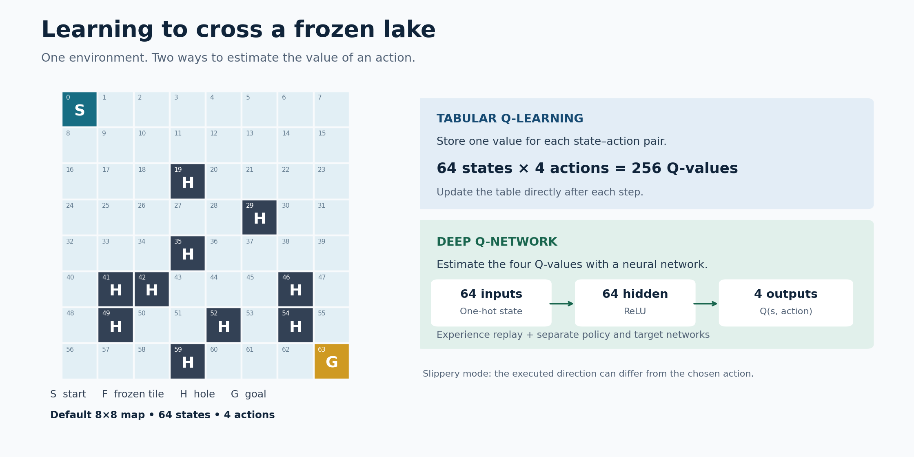
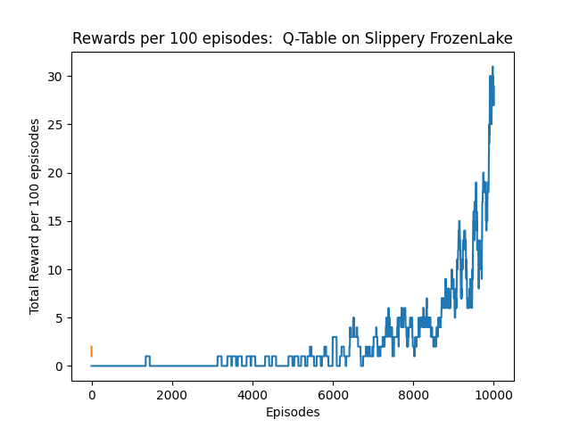
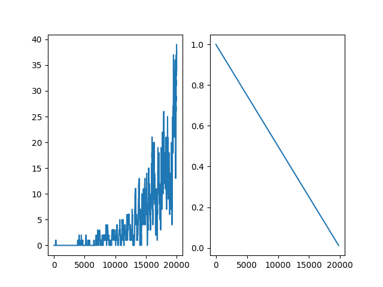
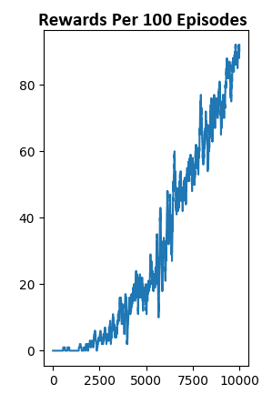
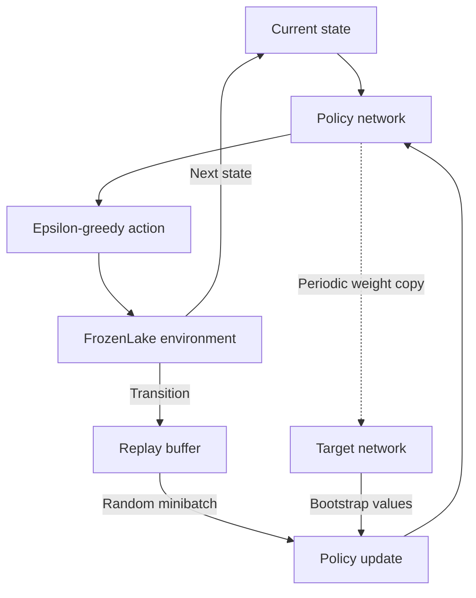

# FrozenLake: Q-Learning and Deep Q-Networks

**Learning to navigate an icy grid with tabular reinforcement learning and a PyTorch neural network.**

An agent must reach a goal without falling into a hole. On slippery ice, the direction it actually moves can differ from the action it chooses. This project implements two ways to learn from that uncertainty: a Q-table that stores state–action values directly, and a Deep Q-Network (DQN) that estimates those values using a neural network.

Built with **Python, Gymnasium, PyTorch, NumPy, and Matplotlib**. Includes saved policies, training plots, and a notebook walkthrough.



[Results](#saved-training-results) · [Quick start](#quick-start) · [Implementation](#how-it-works) · [Open-source contribution](#open-source-contribution)

## The environment

Both Python scripts use Gymnasium's `FrozenLake-v1` with the default **8×8 map**:

- **64 states:** the agent's position on the grid.
- **4 actions:** left, down, right, and up.
- **Sparse rewards:** +1 for reaching the goal; 0 otherwise.
- **Episode endings:** reaching the goal, falling into a hole, or hitting the environment's time limit.

The Q-table script uses slippery ice. The DQN supports both slippery and non-slippery environments, with saved checkpoints for each.

## Saved training results

These are the original plots committed to the repository. They show training behavior with exploration enabled, rather than a separate evaluation of the final policies.

### Tabular Q-learning · slippery ice



Successful episodes become more frequent late in training as exploration decreases.

### Deep Q-Network · slippery ice



The left panel shows rolling rewards; the right shows epsilon, the probability of choosing a random action. Rewards increase but remain variable in the slippery environment. Epsilon is recorded only when an optimization update occurs, so the panels do not use exactly the same horizontal index.

### Deep Q-Network · non-slippery ice



The saved run shows a sustained increase in successful episodes on the deterministic environment.

**Interpreting the plots:** the runs have different training lengths and environment settings, so they do not establish which algorithm performs better. The current plotting code sums up to **101 episodes**, despite the original labels saying “100.” Raw episode histories and full run metadata are not included, so exact success rates and uncertainty estimates are not reported here.

## Quick start

Run commands from the repository root. Python 3.11 matches the original setup instructions; dependency versions are not pinned.

### 1. Install dependencies

```bash
git clone https://github.com/rstrauss127/RL_OpenAI_Gym.git
cd RL_OpenAI_Gym
conda create -n openai_gym python=3.11 -y
conda activate openai_gym
python -m pip install "gymnasium[toy-text]" numpy matplotlib torch
```

For the notebook, also install `jupyterlab` and `ipykernel`. Atari, MuJoCo, TorchVision, and TorchAudio are not required by the FrozenLake scripts.

### 2. Prepare the saved policies

The committed policies live in `Results_QTable/` and `Results_DeepQ/`, but the scripts read and write `QTable/` and `DQN/`. Create those working folders and copy the checkpoints:

```bash
python -c "from pathlib import Path; import shutil; Path('QTable').mkdir(exist_ok=True); Path('DQN').mkdir(exist_ok=True); shutil.copy2('Results_QTable/FrozenLake_Qtable.pkl', 'QTable/FrozenLake_Qtable.pkl'); [shutil.copy2(p, Path('DQN') / p.name) for p in Path('Results_DeepQ').glob('*.pth')]"
```

### 3. Watch a saved agent

**Q-table · slippery ice:**

```bash
python -c "from frozen_lake_Q import run; run(episodes=5, is_training=False, render=True)"
```

**DQN · slippery ice:**

```bash
python frozen_lake_8x8_DeepQ.py
```

The DQN script's default entry point loads the saved slippery policy and renders four episodes. To watch the non-slippery policy:

```bash
python -c "from frozen_lake_8x8_DeepQ import FrozenLake_DeepQ_Learning; FrozenLake_DeepQ_Learning().test_policy(episodes=5, is_slippery=False)"
```

Rendering opens a desktop window. For headless Q-table evaluation, set `render=False`; the DQN's current `test_policy()` always uses a display.

### 4. Train a policy

**Q-table · 10,000 episodes:**

```bash
python -c "from frozen_lake_Q import run; run(episodes=10000, is_training=True, render=False)"
```

**DQN · 20,000 episodes on slippery ice:**

```bash
python -c "from frozen_lake_8x8_DeepQ import FrozenLake_DeepQ_Learning; FrozenLake_DeepQ_Learning().train(episodes=20000, render=False, is_slippery=True)"
```

Set `is_slippery=False` for a non-slippery DQN run. Training saves checkpoints and plots into the working folders prepared above. Repeating a run overwrites its working outputs; the committed `Results_*` files remain available separately. Q-table evaluation also writes a plot, so copy a training plot elsewhere before evaluating if you want to preserve it.

## How it works

### Tabular Q-learning

The agent stores one Q-value for each of the **256 state–action pairs**. An epsilon-greedy policy chooses between exploring a random action and taking the action with the highest estimated value. After each step, the table is updated using the reward and the next state's highest Q-value.

### Deep Q-Network

The DQN encodes the current position as a **64-element one-hot vector**. A fully connected network maps it through **64 hidden units with ReLU** to **four action values**—4,420 trainable parameters per network.

Transitions are stored in a replay buffer. After an eligible episode, a random minibatch is sampled to update the policy network. A separate target network supplies bootstrap estimates and periodically receives a copy of the policy weights.



| Setting | Q-table | DQN |
| --- | --- | --- |
| Value representation | 64 × 4 table | 64 → 64 → 4 network |
| Learning rate | 0.8; reduced to 0.0001 when epsilon reaches zero | 0.001 |
| Discount factor | 0.9 | 0.9 |
| Exploration | Epsilon starts at 1; decreases by 0.0001 per episode | Epsilon starts at 1; decreases by `1 / episodes` per optimization update |
| Replay buffer | None | 10,000 transitions |
| Minibatch | None | 32 transitions |
| Optimization | Direct table update | Adam with MSE loss |
| Environment modes | Slippery | Slippery and non-slippery |

**Implementation details:** DQN optimization begins only after the replay buffer contains more than 32 transitions and the agent has reached the goal at least once. Target synchronization is checked inside that end-of-episode update block when the accumulated step counter exceeds 10; it is not performed exactly every 10 steps.

## Repository guide

| File or folder | Contents |
| --- | --- |
| [`frozen_lake_Q.py`](frozen_lake_Q.py) | Tabular Q-learning, policy loading, rendering, and reward plotting |
| [`frozen_lake_8x8_DeepQ.py`](frozen_lake_8x8_DeepQ.py) | Neural network, replay buffer, training, and policy testing |
| [`demo.ipynb`](demo.ipynb) | Earlier walkthrough; its DQN cells use a 4×4 map |
| [`Results_QTable/`](Results_QTable/) | Saved Q-table and slippery training plot |
| [`Results_DeepQ/`](Results_DeepQ/) | Saved DQN policies and plots for both ice settings |
| [`Open_Source_Contributions/`](Open_Source_Contributions/) | Before-and-after screenshots of the ALE documentation proposal |
| [`frozenLake_env.png`](frozenLake_env.png) | Original 4×4 illustration used by the notebook |

The scripts are the reference for the 8×8 implementation. The notebook uses different settings and checkpoint paths; it is not an interchangeable runner for the saved 8×8 DQN policies.

## Open-source contribution

During this project, I proposed simplifying action-space tables in the **Arcade Learning Environment (ALE)** documentation by removing repeated column headers and presenting actions in a single table.

The discussion began in [PR #602](https://github.com/Farama-Foundation/Arcade-Learning-Environment/pull/602). A maintainer [reported applying the change across environments in PR #561](https://github.com/Farama-Foundation/Arcade-Learning-Environment/pull/602#issuecomment-2856213575). PR #602 itself was closed without being merged.

See the [previous layout](Open_Source_Contributions/Previous_Action_Table_Ale.png) and [proposed layout](Open_Source_Contributions/New%20Action%20Table.png).

## Reproducibility and next steps

The repository preserves example outcomes, but it does not yet provide a controlled benchmark. Useful next steps are to pin dependencies, seed all random sources, save raw reward histories, and evaluate policies over repeated runs with matched episode budgets. Reporting held-out success rate and variability would support a stronger comparison.

## References

- [Gymnasium FrozenLake documentation](https://gymnasium.farama.org/environments/toy_text/frozen_lake/)
- [Gymnasium FrozenLake source and default maps](https://github.com/Farama-Foundation/Gymnasium/blob/main/gymnasium/envs/toy_text/frozen_lake.py)
- [PyTorch reinforcement learning tutorial](https://docs.pytorch.org/tutorials/intermediate/reinforcement_q_learning.html)
- [Arcade Learning Environment](https://github.com/Farama-Foundation/Arcade-Learning-Environment)

## License

[MIT](LICENSE) · Copyright © 2025 Rebecca Strauss
